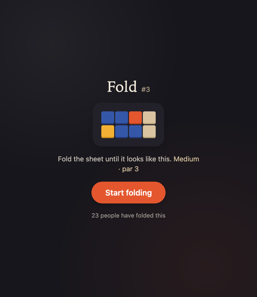
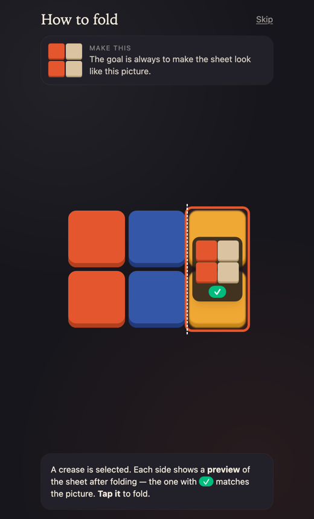
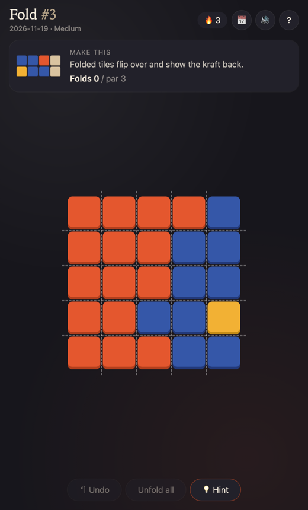

# Fold

**A daily folding puzzle for Reddit.** Fold a sheet of coloured tiles along its creases until it matches the picture, in as few folds as you can. Every fold flips the paper over, so folded tiles show the plain kraft back. Fold again and the colours come back.

Built with [Devvit Web](https://developers.reddit.com/) for Reddit's *Game of the Day* hackathon.

- **Play:** [r/FoldDaily](https://www.reddit.com/r/FoldDaily/)
- **App:** [developers.reddit.com/apps/fold-daily](https://developers.reddit.com/apps/fold-daily)

<p>
  
  
  
</p>

## How it plays

1. Tap a dashed **crease**. Each side shows a **preview** of the sheet after folding that side over; a ✓ means it matches the picture.
2. Tap a side to fold. The flap turns over in 3D and lands on top.
3. Match the picture. Par is the true minimum number of folds, so "⭐ Perfect fold" means you found an optimal solution.

Stuck? **💡 Hint** shows the next fold on an optimal path from wherever you are, and the game warns you when there is no longer enough paper left to make the picture.

## Features

- **One puzzle a day, for everyone.** A new post appears at 00:00 UTC. Difficulty climbs through the week, from a gentle 4×4 with two folds on Monday to a 6×6 with four folds on Sunday.
- **Fair and verified.** Puzzles are generated from a seed, and a breadth-first search proves each par is the minimum. The server replays every submitted solution before it counts.
- **Streaks and flair.** Solve on the day to grow your streak; it shows as user flair ("🔥 5-day Fold streak") in the community.
- **Spoiler-free sharing.** "Comment my result" posts a one-line result (folds, par, time, hints) under the puzzle, never the solution.
- **Community stats.** Fold-count histogram and a daily leaderboard on every post; the feed card shows how many people have folded it.
- **Make your own Fold.** Paint a sheet, fold it 2–4 times and post it as a puzzle for others. The server checks it is solvable, computes its real par and rejects trivial ones.
- **More Folds.** A 30-day archive of dailies and a list of recent community puzzles, each with your own result.
- **Practice mode.** Unlimited unranked puzzles at three difficulty levels after the daily is done.
- **First-run lesson** that teaches the one rule with a single guided fold, plus synthesised sound effects, haptics and Devvit Journeys analytics.

## How it is built

| Part | What it does |
| --- | --- |
| [`src/shared/fold.ts`](src/shared/fold.ts) | Paper model: stacks of layers, folds, top view, BFS solver used for par and hints |
| [`src/shared/daily.ts`](src/shared/daily.ts) | Seeded daily generator with weekly difficulty tiers and quality filters |
| [`src/shared/custom.ts`](src/shared/custom.ts) | Validation for community puzzles |
| [`src/server`](src/server) | Hono API on Devvit: puzzles, solve verification, streaks, boards, sharing, scheduler, Journeys routes |
| [`src/client`](src/client) | React UI: feed card, board with 3D fold animation, tutorial, creator, archive |

Data lives in Devvit Redis. The daily post is created by a scheduled job, and the app installs today's post when it is added to a community.

## Develop

Requires Node 24.18 or newer.

```bash
npm install
npm run test:unit    # engine, generator and validation tests
npm run dev          # playtest in your Devvit test subreddit
```

```bash
npm run preview:local    # UI only, with a mocked API, at http://localhost:5174/preview/game.html
```

## License

BSD-3-Clause. See [LICENSE](LICENSE).
